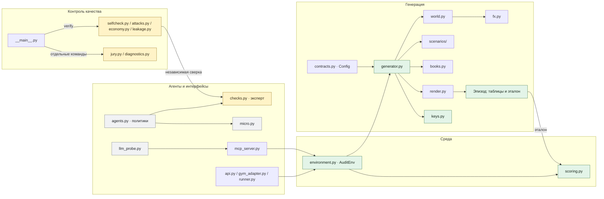
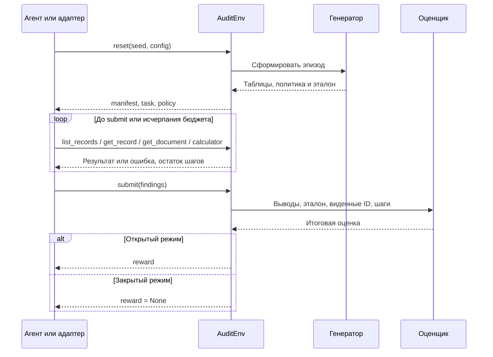
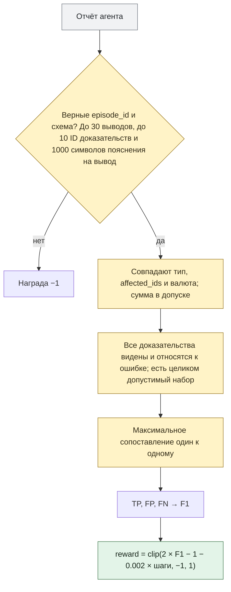
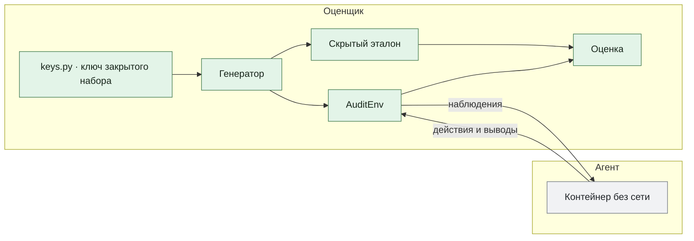
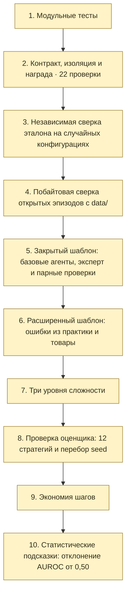
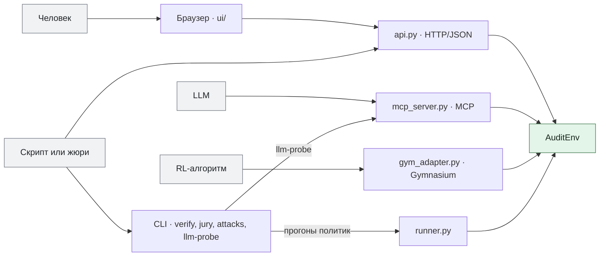
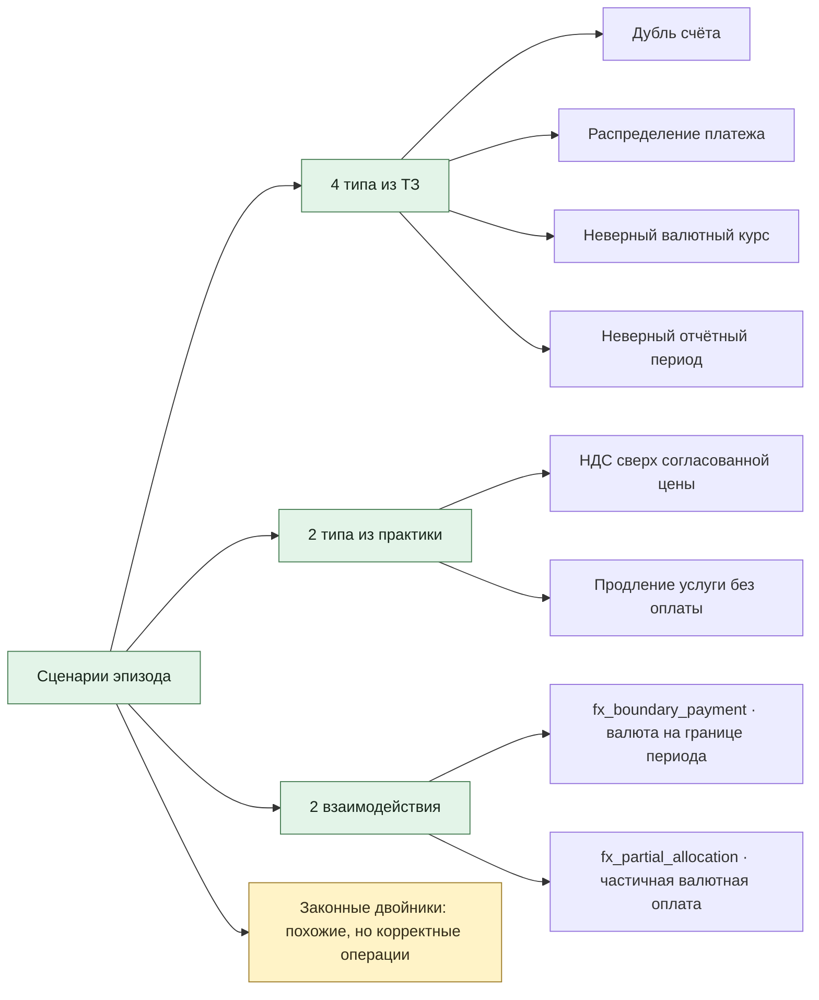

# Архитектура среды ИИ-аудитора

Генератор моделирует месяц учёта. Агент видит документы и проводки, а оценщик отдельно хранит правильные ответы. Зелёный цвет обозначает доверенные компоненты, серый — сторону агента, жёлтый — проверки.

## 1. Карта модулей

[`generator.py`](../audit_env/generator.py) строит мир, применяет сценарии, пересчитывает книги и передаёт результат в [`render.py`](../audit_env/render.py). Запись эпизода и ответов на диск выполняет [`episode_io.py`](../audit_env/episode_io.py).
[`agents.py`](../audit_env/agents.py) предоставляет expert, micro, reconcile, random и flag-all. Эксперт через [`checks.py`](../audit_env/checks.py) независимо выводит ошибки из доступных записей и учётной политики.

## 2. Жизненный цикл эпизода

[`environment.py`](../audit_env/environment.py) ограничивает оцениваемый прогон 100 шагами и 60 секундами. Ошибка инструмента тоже расходует шаг.
При завершении закрытого эпизода результат остаётся у оценщика. Формат действий описан в [протоколе](protocol.md).

## 3. Сопоставление и награда

[`scoring.py`](../audit_env/scoring.py) засчитывает каждую эталонную ошибку один раз. Лишний вывод становится FP, пропуск — FN. Если обе стороны пусты, F1 равен 1.
В стоимость входят шаги осмотра до отправки. Лимиты полей определены в [`contracts.py`](../audit_env/contracts.py).

## 4. Граница доверия

[`keys.py`](../audit_env/keys.py) использует открытое пространство ключей для воспроизводимых учебных эпизодов. Секретный ключ по умолчанию живёт в памяти; конфигурация поддерживает `AUDIT_ENV_SECRET` и `AUDIT_ENV_KEY_FILE`.
[`runner.py`](../audit_env/runner.py) запрещает закрытый запуск недоверенного подпроцесса; `agent_environment()` фильтрует окружение, на POSIX `killpg` завершает группу процессов. Границу для чужого агента обеспечивает контейнер.
[`api.py`](../audit_env/api.py) допускает в открытом режиме только открытый keyspace; [MCP](../audit_env/mcp_server.py) требует закрытый режим для секретного набора. [Тесты изоляции](../tests/test_adapter_isolation.py).

## 5. Что проверяет verify

Порядок задан в [`command_verify`](../audit_env/__main__.py). [`selfcheck.py`](../audit_env/selfcheck.py) проверяет контракт и инварианты, в том числе восстановление чистой книги.
Финальные этапы проверяют [оценщик](../audit_env/attacks.py), [стоимость чтения](../audit_env/economy.py) и [признаки, по которым можно угадать ошибку](../audit_env/leakage.py).

## 6. Кто как подключается

В [HTTP API](api.md), [MCP](../audit_env/mcp_server.py) и [Gymnasium](../audit_env/gym_adapter.py) действия передаются в одну среду. [CLI](../audit_env/__main__.py) дополнительно запускает проверки и агрегирует результаты.
Для модели доступны пять инструментов. В интерактивной MCP-сессии бюджет времени по умолчанию 30 минут, лимит шагов тот же.

## 7. Какие ошибки расследует агент

[`scenarios/`](../audit_env/scenarios/) содержит модули четырёх обязательных типов, [`real_practice.py`](../audit_env/scenarios/real_practice.py) и [`interactions.py`](../audit_env/scenarios/interactions.py).
[Каталог ошибок](error_catalog.md) показывает проводки и доказательства. Генератор также создаёт чистые книги и похожие законные операции, чтобы проверять ложные обвинения.
